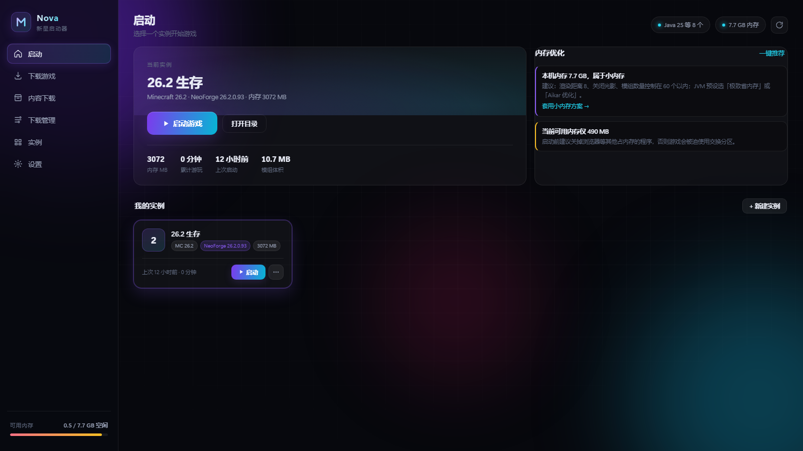
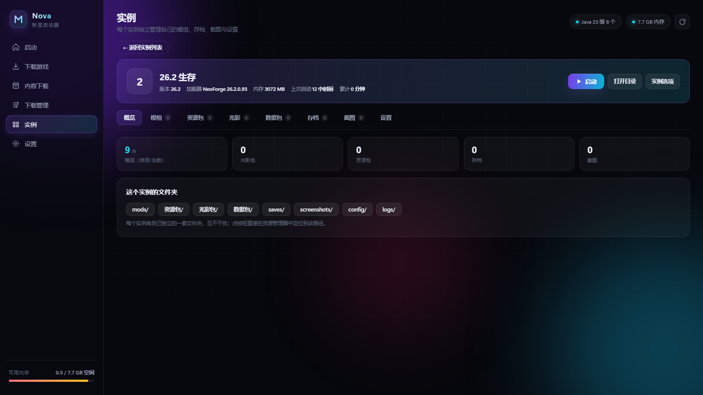
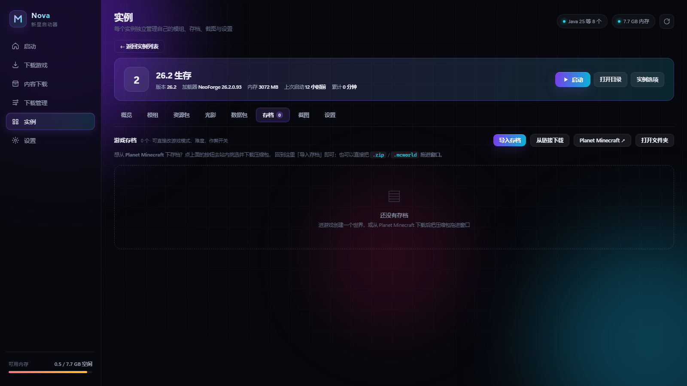

# Nova Launcher · 新星启动器

<p align="center">
  
</p>

<p align="center">
  
  
  
  
</p>

一个用 **Node.js + C#** 从零实现的 Minecraft 启动器。装完就是独立桌面应用，**不依赖浏览器**，
**零第三方运行时依赖**，为低配电脑与国内网络环境优化。

| | |
|---|---|
| **实例隔离** | 每个实例独立的模组 / 资源包 / 光影 / 存档 / 截图，互不干扰 |
| **内存优化** | 启动时按当前可用内存 + 模组数量动态计算，决策过程写进日志 |
| **Java 自动安装** | 检测不到合适版本就自动下载（Corretto / Microsoft / Adoptium 多源回退）|
| **内容下载** | Modrinth 开放 API，支持中文搜索、拼写纠错、相似名匹配 |
| **存档编辑** | 直接改 `level.dat` 的游戏模式 / 难度 / 作弊开关，保存前自动备份 |
| **数据快照** | 每天自动把设置 / 实例 / 存档 / 键位打包存一份，留 10 份，可一键回滚 |
| **整合包** | `.mrpack` 与普通 zip 拖进窗口自动识别，独立建实例 |
| **下载中心** | 实时速度、剩余时间、失败重试，历史记录持久化 |
| **7 套主题** | 深色 6 套 + 浅色 1 套，CSS 变量驱动，即时切换 |
| **自定义主题** | 写一个 JSON 或 HTML 文件就能造主题，拖进窗口即用 |
| **自定义壁纸** | 任意图片铺底，暗度 / 不透明度 / 模糊 / 填充方式可调 |

## 界面

| 实例详情 | 内容下载 |
|---|---|
|  |  |
| **存档管理** | **首页** |
|  |  |

---

> 仓库地址：https://github.com/ttegtgkg/nova-launcher
> 项目介绍页：https://ttegtgkg.github.io/nova-launcher/ （`*.github.io` 在国内可能无法访问，以仓库内文档为准）

---

## 一分钟开始

### 方式一：EXE 安装包（推荐，自带运行时 + 独立窗口）

双击 **`build/NovaLauncher-Setup-1.0.0.exe`**（35 MB），一路下一步即可。

- **独立的桌面应用窗口**：点开就是自己的窗口（有任务栏图标、可最小化/最大化、记住窗口位置），
  **没有地址栏、没有标签页、不需要打开浏览器**
- 安装包**自带 Node.js 运行时与 WebView2 依赖**，目标机器不需要装任何环境
- 可自定义安装位置，默认 `%LOCALAPPDATA%\NovaLauncher`
- 自动创建桌面快捷方式 + 开始菜单项，并注册到「应用和功能」里可正常卸载
- 游戏数据（下载的版本、模组、存档）放在 **程序目录外的 `data`**，卸载/覆盖安装不会丢
- 静默安装：`NovaLauncher-Setup.exe /S`　静默卸载：`NovaLauncher-Setup.exe /UNINSTALL /S`

### 方式二：源码运行（开发用）

> 想要桌面图标？跑一次 `powershell -ExecutionPolicy Bypass -File tools\创建快捷方式.ps1`
> 就会在桌面和开始菜单放好带图标的快捷方式（指向项目根的 `NovaLauncher.exe`）。

1. 确认装了 **Node.js 18+**（`node -v` 能输出版本号即可）
2. 双击项目根目录的 **`NovaLauncher.exe`** —— 同样是独立窗口（会用系统 PATH 里的 node）
3. 或者双击 **`启动.bat`** —— 命令行模式，服务起来后用浏览器打开 `http://127.0.0.1:7420`

两种方式共用同一个 `data` 目录，数据互通。

### 自己构建安装包

```powershell
powershell -ExecutionPolicy Bypass -File build\build.ps1
```

脚本会：下载 Node 运行时（npmmirror 国内镜像）→ 下载 WebView2 SDK（NuGet）→
编译桌面外壳 `NovaLauncher.exe` → 收集文件打包 payload → 用**系统自带的 `csc.exe`** 编译安装程序。
整个过程**不需要安装任何第三方打包工具**（无 Inno Setup / NSIS / Electron / npm 依赖）。

产物：`build/NovaLauncher-Setup-1.0.0.exe`（约 35 MB）

- `build/Installer.cs` —— 安装程序（C# WinForms 手写，深色界面）
- `build/Shell.cs` —— 桌面外壳（窗口 + 子进程管理 + WebView2）
- `build/build.ps1` —— 构建流程

---

## 桌面窗口是怎么来的

不是套壳浏览器，也不是 Electron。方案是 **WinForms 宿主 + WebView2（Edge 内核）**：

```
NovaLauncher.exe (C#, 33 KB)
  ├─ 启动子进程: runtime\node.exe app\server\index.mjs   （本地服务）
  ├─ 轮询 127.0.0.1:7420 直到就绪
  ├─ 创建自己的窗口，用 WebView2 控件把界面画进去
  ├─ 拦截站外链接 → 交给系统默认浏览器（不在窗口里跳走）
  └─ 关闭窗口 → 杀掉 node 子进程，不留后台残留
```

为什么用它：Chromium 内核能完整跑我们那套 CSS 变量 / `color-mix` / backdrop-filter 的界面，
而 **WebView2 Runtime 由 Windows 系统自带**（Win11 和较新 Win10 随 Edge 预装），
不用像 Electron 那样打包 100 MB+ 的浏览器内核，安装包因此只有 35 MB。
若系统确实缺 Runtime，外壳会弹明确提示并给微软官方下载地址，不会静默失败。

窗口大小/位置会记在 `data\shell-window.txt`，下次打开还原。

---

## 功能

### 游戏与版本
- 下载任意**原版**正式版 / 快照（官方清单实时同步）
- 一键安装 **Fabric / Quilt / Forge / NeoForge** 加载器（自动先装对应原版）
- 版本**增量修复**（缺哪个文件补哪个），已装好的部分不会重复下载
- 完整支持版本继承（`inheritsFrom`）、natives 解压、资源索引（assets）、日志配置

### 多实例（版本隔离）
- 每个实例有独立的 `mods / resourcepacks / shaderpacks / saves / config`
- 所有实例**共享**游戏本体、依赖库、资源文件 → 不浪费硬盘
- 实例可复制、改名、单独设置内存 / JVM 参数 / Java / 窗口尺寸
- 游戏本体和库文件在 `data/shared/`，实例在 `data/instances/`

### 内存优化（重点）

**启动时自动优化（默认开启）** —— 每次点启动都会重新算一遍，不需要手动调：

1. 读物理内存总量 → 定基础推荐值
2. 读**当前可用内存** → 定上限（可用不够就别逞强，否则系统换页反而更卡）
3. 数**启用的模组数量** → 加码（模组越多堆越大）
4. 按 128 MB 对齐，并自动挑 JVM 预设（内存紧张 → 省内存预设；大内存 → 高帧率预设）

决策过程会逐条写进启动日志，例如：

```
自动内存优化：
  · 物理内存 7.7 GB，基础推荐 3072 MB
  · 启用模组 3 个 → +256 MB
  · 当前可用 4.2 GB → 上限 4608 MB
  · 使用「Aikar 优化」预设
  → 分配 3328 MB / Aikar 优化（推荐）
```

也可以关掉自动优化改用手动值（设置页 / 实例设置里都有开关）。

手动模式下提供 5 套 JVM 预设：

| 预设 | 适用场景 |
|---|---|
| **Aikar 优化**（默认） | G1GC 全套调优，社区公认减少 GC 卡顿。归属 Aikar / mcflags.emc.gs |
| 均衡 | 小内存机器，参数少、启动快 |
| 极致省内存 | ≤8GB 机器：串行 GC + 字符串去重 |
| 高帧率 | 大内存机器，低停顿 GC |
| 原版默认 | 排查"是不是参数搞的鬼" |

推荐内存对照（按物理内存自动算）：

| 物理内存 | 基础推荐 |
|---|---|
| 4 GB | 1.5 GB |
| 6 GB | 2 GB |
| 8 GB | 3 GB |
| 12 GB | 4 GB |
| 16 GB | 6 GB |
| 24 GB+ | 8 GB |

首页「内存优化」卡片会主动提示问题，比如：分配超过物理内存一半（反而更卡）、没开 JVM 优化、模组装太多、当前可用内存不足，并能**一键应用**推荐配置。

### 中文支持

- **中文名显示**：内置 **492 条**模组中文译名（Sodium→钠、Iris→鸢尾花、Create→机械动力…），
  列表里显示「中文名 + 英文原名」。词典按 Modrinth 真实 slug 编写，
  对照下载量前 1000 的热门榜逐个核对过，**前 400 名零遗漏**
- **兜底意译**：Modrinth 有 8 万个模组，光靠词典追不上。词典没收录时会退一步做逐词意译：
  - 只翻高置信度的常见词（背包 / 存储 / 护甲 / 地牢 / 附魔 …，词表约 400 条）
  - 认不出的词原样保留，品牌名（Create / YUNG's / Macaw's / 加载器名）不硬翻也不拖低命中率
  - **实词命中率不到一半就整体放弃**，宁可显示英文
    —— 「Slice and Dice」翻成「切片与骰子」还不如不翻
  - 举例：`More Backpack Upgrades`→更多背包升级、`Create: Diesel Generators`→Create: 柴油发电机、
    `Detail Armor Bar Reconstructed`→细节护甲状态条重构版
  - 标题带括号缩写的会先拿缩写查词典（`Just Enough Items (JEI)` 靠 JEI 命中）
  - 实测：热门首页 30/30 全中文，20 组常见关键词合计覆盖 **76%**
- **中文搜索**：搜索框直接打中文即可，会转成英文检索词去 Modrinth 查
  （「钠」→ sodium、「物品管理器」→ jei/rei/emi、「机械动力」→ create），
  结果上方会标出「中文检索：钠 → sodium」让你知道发生了什么
- **一键中文翻译**：设置页「中文汉化」→ 安装 **CFPA 简体中文语言包**
  （[CFPAOrg](https://github.com/cfpaorg/minecraft-mod-language-package) 社区维护的模组翻译项目，
  通过 [I18nUpdateMod](https://modrinth.com/project/PWERr14M) 自动下载更新），
  装完后游戏内的模组物品、界面文字都会变中文
- 已装模组如果没记录来源，会用 jar 里的 `mod id` 兜底推断中文名与链接

### 内容详情面板

整合包 / 模组 / 光影 / 资源包 点标题（或「详情」按钮）都会打开详情面板：

```
┌──────────────────────────────────────────────────────────────┐
│ [图标]  钠  Sodium  [模组]                                     │
│         作者 IMS、jellysquid3、douira · 2.6亿 下载 · 更新 13 天前 │
│         [官网] [MC百科] [源码]                                  │
├──────────────────────────────────────────────────────────────┤
│ 简介                                        [翻译简介]         │
│ ┌──────────────────────────────────────────────────────────┐ │
│ │ A high-performance rendering engine replacement for ...  │ │
│ └──────────────────────────────────────────────────────────┘ │
│ [内置译文] 现代化的渲染引擎重写，大幅提升帧数并修复图形问题……    │
├──────────────────────────────────────────────────────────────┤
│ 可用版本  共 168 个 · 当前实例 1.20.1 Fabric 生存 匹配 9 个      │
│ ┌────────────┬──────────┬──────────┬──────────┬────────┐    │
│ │ 版本号      │ 游戏版本  │ 加载器    │ 发布      │        │    │
│ ├────────────┼──────────┼──────────┼──────────┼────────┤    │
│ │ 0.5.13 正式 │ 1.20.1   │ fabric   │ 3 天前    │ 已装   │    │
│ │ 0.5.12 测试 │ 1.20.1   │ fabric   │ 1 个月前  │ 安装   │    │
│ └────────────┴──────────┴──────────┴──────────┴────────┘    │
└──────────────────────────────────────────────────────────────┘
```

- **名称**：中文名 + 英文原名 + 内容类型标签
- **作者**：从 Modrinth 团队成员接口拉取（Owner 排在前）
- **简介**：英文原文常驻显示；点「翻译简介」按需翻译成中文
- **跳转**：官网（Modrinth 项目页）/ MC百科 / 源码，一键调系统浏览器
- **版本表**：版本号 · 游戏版本 · 加载器 · 发布日期 · 安装按钮，
  **匹配当前实例的版本自动置顶并高亮**，已安装的直接标「已装」
- 匹配 0 个时会说明原因（是「没有这个加载器」还是「没有这个游戏版本」），不会只给个空表
- 深链接：`?detail=sodium` 可直接打开某个项目的详情

**翻译引擎**：用 [MyMemory](https://mymemory.translated.net/) 免费接口（en→zh-CN）。
实测 Google 的 translate 端点在当前网络不可达、微软端点需要授权，MyMemory 可用且质量够用。
做了两件事省配额：**磁盘缓存**（翻译过的句子永不再请求）和**分段**（接口单次限 ~500 字符）。
热门模组另有一份**人工撰写的中文简介**（`server/i18n.mjs` 的 `MOD_CN_DESC`，覆盖 60+ 个常见模组），
有内置译文时直接显示、不用调翻译接口。

### 官网与 MC 百科跳转

每个模组 / 整合包 / 光影卡片都带跳转按钮：

- **官网** → Modrinth 项目页
- **MC百科** → `search.mcmod.cn` 用中文名搜索（中文资料最全）
- **源码** → 项目源码仓库（有的话）

从 Modrinth 安装时会自动记录来源（项目 id、slug、中文名、图标、源码地址）到实例的
`nova-sources.json`，所以**本地已装的内容也能跳转**，不是只对在线结果有效。
点击后调 `/api/system/open-url` 用系统默认浏览器打开（走 `rundll32`，不经过 shell，避免 URL 注入）。

### 实例：一切都挂在实例下面

信息架构是「**先选实例，再管内容**」，模组之类的设置都是实例的子项，天然隔离：

```
实例
 ├─ 概览      模组/光影/资源包/存档/截图数量 + 每个文件夹的一键跳转
 ├─ 模组      ← 只影响这个实例
 ├─ 资源包
 ├─ 光影
 ├─ 数据包
 ├─ 存档      可改游戏模式、难度、作弊开关，支持备份/删除
 ├─ 截图      缩略图墙，可放大、定位、删除
 └─ 设置      内存、JVM 预设、Java、窗口、自动优化、删除实例
```

每个实例有自己的 `mods` / `resourcepacks` / `shaderpacks` / `datapacks` / `saves` / `screenshots`，
**互不干扰**；切换 Tab 时有计数徽标，一眼看出装了多少。

### 内容下载（和管理彻底分开）

「内容下载」页只负责**找和装**：选目标实例 → 选类型（模组/光影/资源包/数据包/整合包）→ 搜索 → 安装。
装好之后要**启用 / 禁用 / 删除 / 导入**，都在「实例 → 对应实例 → 模组」里做。

- 按**该实例的 MC 版本 + 加载器**精确搜索，支持中文关键词
- **模糊搜索**：不用打全名，也不用拼对
  - `sodi` → Sodium（Modrinth 自带前缀匹配）
  - `soduim` / `soidum` → **Sodium**（拼写纠错，编辑距离）
  - `jeii` → JEI、`applskin` → AppleSkin、`sdium` → Sodium/Indium/Radium
  - `complementry` → Complementary Shaders（光影同理）
  - 纠错补进来的结果会标一个紫色「相似」角标，不会和精确命中混淆
  - **中文别名**：口语叫法也能搜到，例如「连锁破坏 / 连锁挖矿」→ VeinMiner、
    「物品管理器」→ JEI、「小地图」→ Xaoero 系列（见 `server/i18n.mjs` 的 `CN_ALIASES`）
  - 中文转换只取**最相关的一个词**去检索 —— Modrinth 是 AND 语义，
    多个 slug 拼在一起会一条都匹配不到（这是早先「钠」只搜出 2 条的根因）
  - **Modrinth 上没有的东西**（例如 FTB Ultimine 本体、大量国产/CurseForge 独占模组）：
    搜不到时会明确说明原因，并给出「在 MC百科 搜索」「在 CurseForge 搜索」两个跳转按钮，
    下载后拖进窗口即可安装
  - 实现见 `server/search.mjs`：本地缓存 2000 条热门内容做索引，
    打分顺序是 完全一致 > 前缀 > 包含 > 词首缩写 > 编辑距离(≤2~4且错误率≤35%) > 子序列(覆盖率≥40%)，
    低于 50 分的不补，避免塞一堆无关结果
- 站内直连下载，自动处理**必需依赖**（递归安装）
- **搜索结果分页**：Modrinth 一次最多返回 100 条，但「共 8379 个」不是摆设 ——
  每页 30 个，底部 `第一页 / 上一页 / 页码 / 下一页 / 最后一页` 可以一直翻到最后一条
  - 与实例内列表共用同一套分页组件（`pagerHtml` / `bindPager`）
  - 翻页时会**原样重放这次的检索条件**，不会因为你顺手改了搜索框却没回车就跑偏
  - 「按实例过滤后没结果 → 放宽到全部版本」的判断只在第 1 页做一次，
    后续翻页沿用它，保证第 2 页不会突然又变回过滤条件
  - 深翻页失败（页码过深 / 网络抖动）只弹提示，不会把已经显示的列表清空
- 支持 Modrinth **整合包**（`.mrpack`）：自动装版本、加载器、全部模组，一步到位
- 也支持导入本地 `.zip` 整合包和 `.mrpack`

### 内容管理细节（实例内）

- 自动读取 jar 内的 `fabric.mod.json` / `mods.toml` / `mcmod.info` / `pack.mcmeta`，
  显示**真实名称、版本、作者、简介**，而不是文件名
- 一键启用 / 禁用（改 `.disabled` 后缀，不删文件）
- 从电脑导入、删除、**一键跳到对应文件夹**
- **分页浏览**：每页 30 个，底部 `第一页 / 上一页 / 页码 / 下一页 / 最后一页`，
  左侧显示「第 31–60 个 · 共 75 个 · 第 2/3 页」。装了 300 个模组也不会滚到怀疑人生
  - 页码多于 7 个时中间折叠成 `…`，首末页始终可见
  - 翻页只重绘当前页，不再请求一次 API
  - 每翻一页自动把标签栏滚回视野顶部，不会翻完不知道自己在看什么
  - 删到当前页空了会自动回退一页；换实例则重置到第 1 页

### 存档管理（含下载 / 导入 / 导出）

**获取存档**（Modrinth 没有存档分类，所以走这三种方式）：

- **导入存档**：选本地的 `.zip` / `.mcworld`，启动器自动识别结构并解压到该实例的 `saves/`
  - 支持三种包结构：整包就是一个存档、包里多个存档、多了 `saves/` 一层
  - 重名自动加 `(1)` `(2)` 后缀，不会覆盖已有存档
- **从链接下载**：粘贴 http/https 直链，后台下载 + 自动解压，进度在「下载管理」里看
- **导出存档**：把某个存档打包成 zip（放到 `saves-backup/` 并自动打开文件夹），
  方便发给朋友或换电脑；也可以直接访问 `/api/saves/export` 走浏览器下载

**编辑存档**（不用进游戏）：

- 读取真实 `level.dat`（gzip + NBT 二进制），显示中文摘要
- 可改：**游戏模式**（生存/创造/冒险/旁观）、**难度**、**允许作弊**、**极限模式**、
  **锁定难度**、**存档名**、**天数**
- 保存前自动备份 `level.dat.nova-bak`，游戏运行中会拒绝修改（避免被游戏覆盖）
- 「备份」按钮把整个存档目录复制到 `saves-backup/<名字>-<时间>/`

**关于 Planet Minecraft**：`planetminecraft.com` 是有海量存档的社区，但它**全站套了 Cloudflare 防护**
（实测首页、搜索页、连 RSS 都返回 403，`server: cloudflare`）。启动器**不会去绕过**它——
那既不可靠也违反站点条款。所以做的是「**一键跳转 + 顺滑导入**」：

1. 存档页点 **Planet Minecraft ↗**，用系统浏览器打开该站存档区（浏览器能正常过 CF 验证）
2. 挑好存档、下载 `.zip`
3. 回来把压缩包**直接拖进启动器窗口**，或点「导入存档」

拖拽是全局的，按扩展名自动分发：`.jar` → 模组装进当前实例；`.mrpack` → 装整合包；
`.zip` / `.mcworld` → 先当存档导入，若包里没有 `level.dat` 再让你选资源包 / 光影 / 数据包。

### 数据快照（自动备份）

游戏文件丢了都能重下，真正找不回来的是**设置、实例配置、模组来源、存档和键位**。
所以启动器每天自动把这几样打包成一份快照，放在 `data/backups/`：

- 触发：启动 6 秒后检查，距上次超过 24 小时就存一份（后台跑，不打扰）
- 内容：`config.json`、每个实例的 `instance.json` / `nova-sources.json` /
  `options.txt` / `servers.dat`、以及整个 `saves/` 目录
- 体积：游戏本体、依赖库、模组 jar **不备份** —— 一份通常几 MB
- 轮转：最多留 10 份，超出删最旧的；单文件超 128 MB 跳过（超大存档不硬扛）
- 恢复：设置 → 数据快照 → 选一份 → 恢复。**恢复前会先把当前状态自动存一份**，
  点错了还能退回来。恢复后重启启动器生效

> NBT 读写是自己实现的（`server/nbt.mjs`，覆盖全部 13 种 TAG 类型）。
> 正确性不是靠自测：用官方 Minecraft 1.20.1 服务端生成真实世界 → 用它生成的 `level.dat`
> 做修改 → **再把改过的世界交给服务端加载**，日志显示 `Done (8.135s)` 正常启动，改动全部保留。

### 截图管理

- 缩略图墙，按时间倒序
- 点击放大（灯箱），可「在文件夹中显示」或删除
- 游戏里按 F2 截的图会自动出现在这里

### 文件夹直达

每个实例都有一排按钮，点一下直接在资源管理器打开对应目录：
`mods/` `resourcepacks/` `shaderpacks/` `datapacks/` `saves/` `screenshots/` `config/` `logs/`
（不用自己去 `%LOCALAPPDATA%` 一层层翻）

### Java：自动检测 + 自动安装

- 启动器会扫描本机的 Java（注册表路径、常见安装目录、`JAVA_HOME`、`PATH`、自带的 runtime 目录），
  读出每个的版本、位数、厂商
- **点启动时**如果发现没有满足要求的 Java（1.20.1 要 17、1.20.5+ 要 21、老版本要 8），
  会**自动下载并安装**到 `data/runtime/`，装完继续启动，全程写进启动日志
- 「设置 → Java 体检」能看到每个实例需要哪个版本、当前是否满足，缺哪个一键补
- 下载源按实测速度排序，逐个回退：**Amazon Corretto（~2.7 MB/s）→ Microsoft OpenJDK（~0.46 MB/s）→ Adoptium**
  （Adoptium 官方 API 在本机网络下会超时，所以只作兜底）


### 下载管理中心
- 独立的「下载管理」页面，集中看所有任务的**实时速度、已下载字节、剩余时间**
- 每个任务显示：类型标签、进度条、文件数、阶段说明
- **支持取消**（立即停止剩余文件的下载，不算失败）
- **历史记录持久化**到 `data/downloads-history.json`，重启启动器也还在
- 失败记录保留完整日志，可**一键重试**（按原始参数重新发起）
- 顶部统计：进行中任务 / 当前总速度 / 累计下载量与文件数 / 成功率
- 历史可按「全部 / 成功 / 失败」筛选、可清空
- 侧边栏角标实时显示进行中的任务数

### 主题
7 套配色，设置页一键切换，即时生效、本机记住：

| 主题 | 风格 |
|---|---|
| **Nova** | 深空紫青（默认） |
| 极夜 | 银灰冷调、克制 |
| 深海 | 蓝青、安静专注 |
| 落日 | 橙粉、温暖 |
| 森野 | 绿青柠、清爽 |
| 樱花 | 粉紫、柔和 |
| **晨曦** | 浅色主题，适合白天 |

配色全部由 CSS 变量驱动（`--accent` / `--grad-a` 等），衍生色用 `color-mix()` 自动推导，
所以换主题时按钮渐变、选中边框、进度条、背景光斑会一起变，不会漏掉某处硬编码的颜色。
支持 `?theme=light` 这样的 URL 参数临时预览（不写入本地设置）。

### 自定义主题（JSON 或 HTML）

内置主题之外，自己写一个文件就能加主题。两种格式任选，**拖进窗口**或点「导入主题文件」都行：

**JSON** —— 最直接，只需要写想覆盖的变量，没写的自动沿用 Nova 的默认值：

```json
{
  "name": "示例 · 熔岩",
  "desc": "深黑底 + 熔岩橙",
  "vars": {
    "--bg": "#0b0604",
    "--panel": "#140c08",
    "--accent": "#ff6b1a",
    "--accent-2": "#ffd166",
    "--text": "#fdf2e6"
  }
}
```

也支持扁平写法（`{"name":"x","bg":"#111","accent":"#f00"}`，`bg` 会自动补成 `--bg`）。

**HTML** —— 想连布局一起改就用这个，`<style>` 里的内容会原样注入：

```html
<!doctype html>
<html><head>
  <meta name="nova-theme" content="示例 · 极光">
  <style>
    :root { --bg: #04070c; --accent: #2dd4bf; --accent-2: #a78bfa; }
    .btn { border-radius: 12px; }
  </style>
</head></html>
```

主题名取 `<meta name="nova-theme">`，没有就取 `<title>`，再没有就用文件名。
`.css` 文件直接写 `:root{...}` 也认。

几个实现上的取舍：

- **主题就是一个变量集合** —— 自定义主题注入的是 `:root[data-theme="custom-xxxx"] { ... }`，
  和内置主题走完全相同的选择器路径，所以热切换、渐变过渡、预览色块全部天然一致
- **导入时清洗** —— 项目主打完全离线，`@import` 和外链 `url(http://...)` 会被剥掉，
  免得一个「主题文件」把联网请求带进启动器；变量值里出现 `;` `}` `<` 这类能提前闭合声明的字符也会被丢弃
- **同名视为更新** —— 改一版主题重新导入，不会多出一张卡片
- 存在 `data/themes/*.json`，跟着数据快照一起备份

设置页有「下载示例模板」，会存下示例 JSON 和 HTML 各一份，改完拖回去就能用。

### 自定义壁纸

任意图片铺在背景光斑下面，上面再叠一层**跟随主题的背景色遮罩**——深色主题压暗、浅色主题压亮，
所以不管你放什么图，文字都读得清。这层遮罩用的是 `color-mix(in srgb, var(--bg) 55%, transparent)`，
换主题时会自动变，不用分别调。

| 可调项 | 范围 | 说明 |
|---|---|---|
| 暗度 | 0 – 92% | 主题底色压在图片上的比例，调高了字更清楚 |
| 不透明度 | 10 – 100% | 图片本身的不透明度 |
| 模糊 | 0 – 24 px | 高斯模糊，适合把照片当氛围底 |
| 填充方式 | 铺满 / 完整显示 / 原始大小 | 对应 `cover` / `contain` / `auto` |

图片复制进 `data/wallpapers/`（上限 24 MB，jpg / png / webp / gif / bmp / avif），换图时旧的自动删掉。
上传会校验文件头，改了扩展名的压缩包也会被挡下来。拖进窗口的图片默认当壁纸用。

### 其他
- 下载源可切换：**自动**（镜像优先、失败回落官方）/ 仅镜像 BMCLAPI / 仅官方
- 一键安装 Java（Eclipse Adoptium 官方 API，Java 8 / 17 / 21）
- 实时显示内存占用、游戏运行时长、下载队列进度
- 游戏日志面板（实时），支持强制结束
- 任务队列：所有下载/安装都有进度，失败有原因

---

## 目录结构

```
nova-launcher/
├── 启动.bat                  启动入口（双击这个）
├── package.json
├── 开源归属与致谢.md          ← 第三方归属声明（必读）
├── README.md
├── server/                   后端（Node 原生，无依赖）
│   ├── index.mjs             HTTP 服务 + 全部 API + 游戏进程管理
│   ├── core.mjs              路径/配置/任务队列/ZIP/并发下载器
│   ├── mc.mjs                Java 探测/Mojang 安装/加载器/启动与 JVM 预设
│   ├── content.mjs           实例与内容管理 + Modrinth + 整合包
│   ├── theme.mjs             自定义主题解析 + 壁纸管理
│   ├── backup.mjs            数据快照（每日自动备份 / 恢复）
│   └── nbt.mjs               NBT 读写（存档 level.dat）
├── web/                      前端（纯手写 HTML/CSS/JS，无框架无 CDN）
│   ├── index.html
│   ├── style.css
│   └── app.js
└── data/                     运行时数据（自动创建）
    ├── shared/               所有实例共享
    │   ├── versions/         游戏版本 jar + json
    │   ├── libraries/        依赖库
    │   └── assets/           资源文件
    ├── instances/            每个实例一个目录（= 游戏目录）
    ├── runtime/              自动下载的 JDK
    ├── cache/                版本清单缓存、整合包临时文件
    ├── themes/               自定义主题（*.json）
    ├── wallpapers/           自定义壁纸图片
    ├── backups/              数据快照
    └── config.json           启动器配置
```

想换数据位置，把 `data/` 整个挪走再改 `server/core.mjs` 里的 `DATA` 即可。

---

## 常见问题

**Q：端口 7420 被占用？**
`set NOVA_PORT=7500` 后再运行（或在 `启动.bat` 里加一行）。

**Q：提示没有 Java？**
到「设置 → Java 运行时」点「装 Java 17」或「装 Java 21」，从 Adoptium 官方下载。
1.20.1 需要 Java 17，1.20.5+ 需要 Java 21，老版本（≤1.16）需要 Java 8。

**Q：下载很慢？**
「设置 → 下载源」确认是「自动」或「仅镜像 BMCLAPI」。
资源文件（assets）本身走官方 CDN 通常更快，启动器已在 `auto` 模式下自动分流。

**Q：游戏启动闪退？**
「启动」页底部会显示实时日志。看最后的 `Caused by:` 那一行。
常见原因：内存给小了、Java 版本不对、模组装了不兼容的版本。
把 JVM 预设切成「原版默认」再试，能排除参数问题。

**Q：能登正版账号吗？**
目前使用**离线用户名**。正版账号请用官方启动器登录后游玩。
本启动器**不提供、也不会提供**任何正版验证绕过功能。

**Q：整合包装完打不开？**
部分整合包内含 Forge/NeoForge 的安装器需求，或含 CurseForge 专属模组（无法自动下载）。
看任务日志里的失败项，手动补上对应文件即可。

---

## 关于开源

本项目为**原创实现**，MIT 许可。所有使用、调用或借鉴的第三方成果都记录在
**[`开源归属与致谢.md`](./开源归属与致谢.md)** 中，启动器内「设置 → 关于与开源声明」也能直接查看。

重点标注：

| 项目 | 作者 | 许可 | 用途 |
|---|---|---|---|
| BMCLAPI | bangbang93 | MIT | 下载镜像 |
| Modrinth | Modrinth 团队 | 开放 API | 模组/整合包数据源 |
| Aikar's Flags | Aikar | MIT | JVM 优化参数 |
| Fabric / Quilt | FabricMC / QuiltMC | Apache-2.0 | 加载器元数据 |
| Forge / NeoForge | MinecraftForge | LGPL-2.1 | 加载器安装器 |
| Eclipse Adoptium | Adoptium | GPL-2.0+CE | JDK 下载 |
| PCL2 / HMCL / Prism | 各自团队 | MIT / GPL-3.0 | **仅设计思路参考，未使用任何源代码** |

Minecraft 版权归 **Mojang Studios / Microsoft** 所有。本项目不包含游戏本体、不重新分发任何模组，
仅在用户主动操作时按其官方公开地址下载。请购买正版以支持开发者。

---

## 技术说明

- 后端：Node.js 原生 `http` / `https` / `zlib` / `crypto` / `fs`，**零 npm 依赖**
- ZIP 解析：手写中央目录解析 + `zlib.inflateRawSync`（用于整合包、读取 mod 元数据）
- 下载器：并发池 + 原子写入（`.part` → rename）+ SHA1 校验 + 多源回退 + 重试
- 前端：原生 DOM，无框架、无 CDN、无外部字体，完全离线可用
- 通信：REST JSON + 1.2s 任务轮询 + 1.5s 日志轮询
- 主题：CSS 自定义属性 + `color-mix()` 派生色，`[data-theme]` 切换

### 为什么下载不用内置 `fetch`

Node 内置 `fetch`（undici）有两个坑，实测都会让下载永久卡死：

1. **硬编码 10 秒连接超时**。`cdn.modrinth.com` 在国内有时要几十秒才连上，
   undici 直接抛 `UND_ERR_CONNECT_TIMEOUT`，而 PowerShell 同样的 URL 能下完（只是慢）。
2. **`AbortController` 的超时只覆盖响应头阶段**。一旦响应头返回、开始读 body，
   连接停滞就再也没有超时保护，任务会永远停在某个百分比。

所以下载层用 `node:https` 自己实现（`server/core.mjs` 的 `httpGet`）：

- 连接阶段交给操作系统（不受 10 秒限制）
- **空闲超时**：socket 25 秒收不到任何数据才放弃，慢速但持续的下载不会被误杀
- **总超时**兜底，防止极端情况无限挂起
- 支持重定向（Mojang / Modrinth 都靠 302 跳到 CDN）、gzip/br 解压、keep-alive 连接复用
